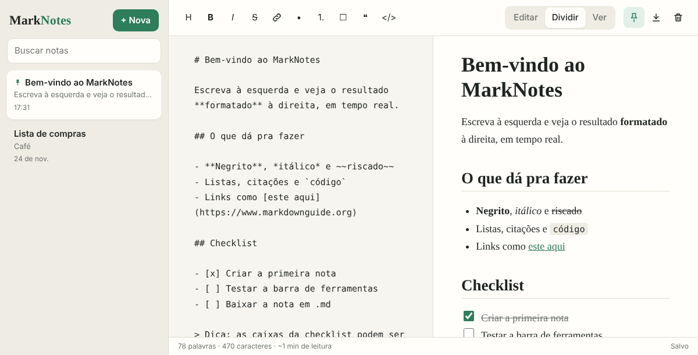

# MarkNotes — Notas em Markdown

Bloco de notas com suporte a **Markdown** e prévia formatada em tempo real enquanto você digita.

🔗 **[Ver o site no ar](https://iamviniciuslima05.github.io/PROJETO-MarkNotes/)**



## Funcionalidades

- Criar, buscar, **fixar** e excluir notas
- **Prévia em tempo real** lado a lado, só editor ou só leitura
- Conversor de Markdown **próprio**, sem bibliotecas: títulos, negrito, itálico, riscado, código, blocos de código, listas, citações e links
- **Checklists clicáveis** direto na prévia
- Barra de formatação e atalhos (Ctrl+B, Ctrl+I)
- Listas continuam sozinhas ao apertar Enter
- Contagem de palavras e tempo de leitura
- **Baixar** a nota como arquivo `.md`
- Salvamento automático no **localStorage**

## Tecnologias

HTML5 · CSS3 · JavaScript · Markdown · localStorage

## Estrutura

```
index.html
css/style.css
js/markdown.js   → conversor de Markdown seguro
js/script.js     → notas e editor
```

## Como rodar

Não precisa instalar nada: baixe o projeto e abra o `index.html` no navegador, ou acesse a versão publicada acima.

---
Feito por **Vinicius Lima** · [Portfólio](https://viniciuslimadev.netlify.app) · [LinkedIn](https://www.linkedin.com/in/viniciuslima25/)
